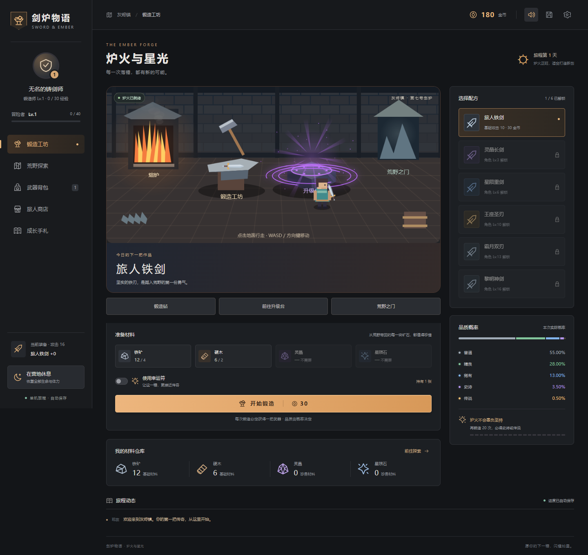
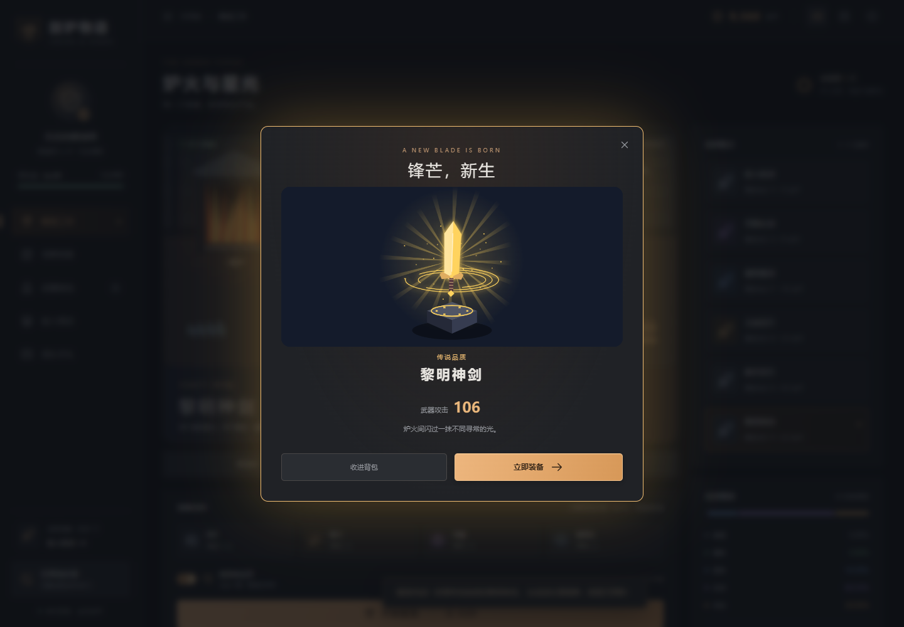
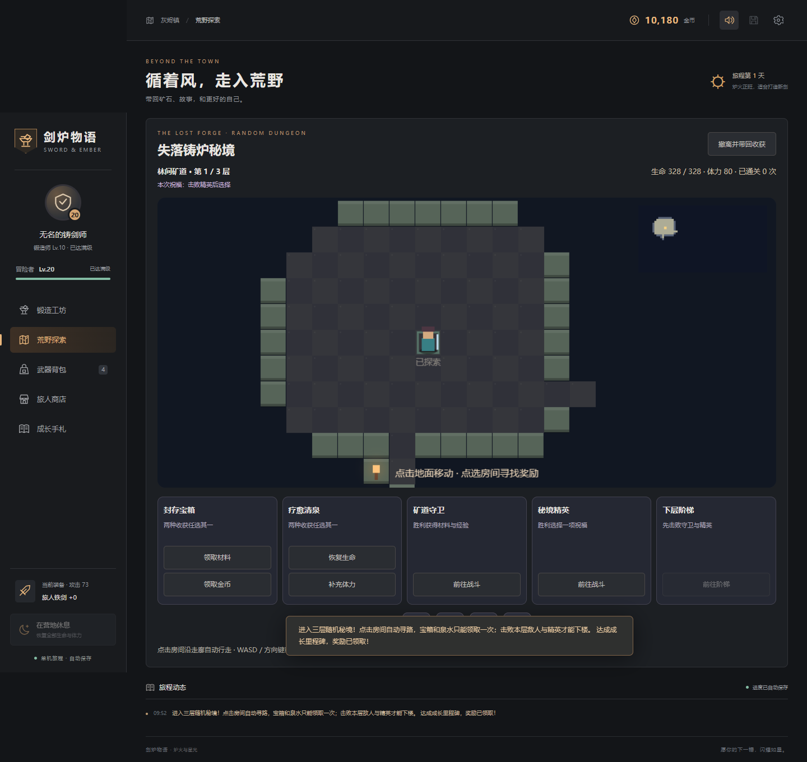

# 剑炉物语 · Sword Forge

**从一把新手剑，到亲手铸出的传说。**

一款中文离线单机锻造养成游戏：在六域收集材料，深入随机秘境，把收获带回工坊，打造和强化下一把宝剑。使用 **C11 游戏核心 + Canvas 2D 界面**，支持 Windows 与 Android，也适合 C 语言学习者继续扩展。

[下载游戏](https://github.com/1ur-xiaoxiao/sword-forge/releases/latest) · [版本记录](CHANGELOG.md) · [完整玩法](docs/GAMEPLAY.md) · [开源借鉴](docs/OPEN_SOURCE.md)



## 下载即玩

| 平台 | 下载 | 启动方式 |
|---|---|---|
| Windows | [单文件 EXE](https://github.com/1ur-xiaoxiao/sword-forge/releases/latest/download/SwordForge-Windows.exe) | 放进可写文件夹，双击运行；使用本机 Edge 或默认浏览器显示游戏 |
| Android 8.0+ | [正式签名 APK](https://github.com/1ur-xiaoxiao/sword-forge/releases/latest/download/SwordForge-Android.apk) | 在手机下载安装，离线游玩；包含 ARM64、ARM32、x86_64 |
| 完整源码 | [源码 ZIP](https://github.com/1ur-xiaoxiao/sword-forge/releases/latest/download/SwordForge-Source.zip) | 包含源码、构建脚本、文档与测试；安装包单独下载 |

玩游戏无需编译器、Node 或 Python。音效默认开启，首次点击后播放；顶部按钮可静音。电脑和手机各有 **4 个独立存档位**，每次有效操作自动保存，设备之间不自动同步。

**更新保留进度：** Windows 关闭游戏后替换 EXE，保留旁边的 `saves` 文件夹；Android 用新版 APK 覆盖安装，避免卸载或清除数据。请不要直接双击源码中的 HTML。

## 玩什么

**探索 → 材料与金币 → 锻造 / 强化 → 更强的装备 → 更深的探索。**

- **六域成长：** 六张地区地图、18 种普通敌人、6 名首领。首通获得永久战功，解锁后续地区与高阶配方。
- **概率锻造：** 六种配方、五档品质；每次必得武器。连续 19 次未出史诗或传说，第 20 次至少史诗；幸运符与锻造师等级改善概率。
- **装备养成：** 强化至 +10，保护符保住失败等级；淘汰武器可批量回收，再投入下一轮锻造。
- **三层随机秘境：** 房间与走廊随机生成，点击寻路，迷雾随探索揭开。宝箱、泉水、守卫与精英组成每层目标，三选一祝福改变本次旅程。
- **可持续的资源循环：** 免费休息恢复体力与生命；药水、泉水帮助保住最高 40% 连胜加成。撤离保留已获得收获，战败损失 10% 金币。
- **2D 反馈：** 工坊可行走；史诗紫光、传说金光、落锤火花与独立升级台。战斗双方血条紧邻角色，手机同屏操作。

终局目标：击败六域首领，铸成 **传说「黎明神剑 +10」**。详细概率、成本、战斗与存档规则见 [玩法手册](docs/GAMEPLAY.md)。

| 传说锻造 | 随机秘境 |
|---|---|
|  |  |

## 如何实现

数值、资源扣除、随机结果与存档由 C 核心决定；界面读取状态并发送操作，动画跟随真实结果。Windows 用本机 HTTP 接口，Android 用 JNI 调用同一份核心；两端都内置资源，可离线运行。

| 想修改的内容 | 从这里开始 |
|---|---|
| 材料、配方、地图与敌人数值 | [`src/data.c`](src/data.c)、[`include/game.h`](include/game.h) |
| 随机品质、保底、强化 | [`src/forge.c`](src/forge.c) |
| 背包、道具、成长与批量回收 | [`src/game.c`](src/game.c) |
| 回合战斗、采集事件、秘境与祝福 | [`src/adventure.c`](src/adventure.c)、[`src/delve.c`](src/delve.c) |
| 四存档与 V1–V4 兼容 | [`src/save.c`](src/save.c)、[`src/game_api.c`](src/game_api.c) |
| 工坊动画、地图、手机布局 | [`web/scene.js`](web/scene.js)、[`web/dungeon.js`](web/dungeon.js)、[`web/styles.css`](web/styles.css) |

## 本地开发

Windows 安装 MinGW-w64，将 GCC 加入 PATH，或放在 `D:\mingw64\bin`。在项目目录执行：

```powershell
powershell -ExecutionPolicy Bypass -File build.ps1 -Test
powershell -ExecutionPolicy Bypass -File package.ps1 -Test
```

第一条编译开发版并运行核心测试；第二条生成根目录 `剑炉物语.exe`，并验证单文件版。保留了 [终端学习入口](docs/README-console.md)，日常游戏使用图形界面。Android 构建与环境见 [安卓说明](android/README.md)。

已完成 **77 组验收**：C 核心、单文件接口、Edge 界面、2D 场景、150 个地图种子与 Android WebView。具体环境和边界见 [验证记录](VERIFICATION.md)；安卓实测为 x86_64 模拟器，ARM 两种架构完成编译打包。

## 开源借鉴与作者

| 来源 | 本项目的使用方式 |
|---|---|
| [rot.js](https://github.com/ondras/rot.js) · Ondřej Žára · BSD-3-Clause | **实际内置 2.2.1 代码**，用于 Rogue 地图、A* 寻路和精确阴影视野；[完整许可](web/vendor/ROT-LICENSE.txt)随 EXE / APK 分发 |
| [A Dark Room](https://github.com/doublespeakgames/adarkroom) | 参考探索、资源、成长的循环；未复制代码或素材 |
| [dungeongeneration](https://github.com/stefanweck/dungeongeneration) | 参考房间、走廊与迷雾玩法；未复制代码或美术 |
| [Ares](https://github.com/okn1ce/Ares)、[Idle Blacksmith](https://github.com/BloodyVerrick/Idle-Blacksmith)、[Block UI](https://github.com/malilion/BlockUI) | 参考锻造页面、资源信息与物品格子的组织；界面重新实现 |

原创数值、角色图形、场景、音效与核心代码由本项目实现，版权归 **1ur-xiaoxiao**。原创部分尚未单独声明开源许可；第三方 rot.js 保持其 BSD 许可。[融合位置与固定提交](docs/OPEN_SOURCE.md) · [界面参考记录](docs/UI_REFERENCES.md)。

## 更新与版本

当前版本 **v3.1.0 · 2D 秘境版**。已将真实的 v2.0.0 六域版归档导入历史；后续每次修改用 Git 提交记录，正式版用版本标签和 [Releases](https://github.com/1ur-xiaoxiao/sword-forge/releases)保存下载文件与更新说明。

[更新日志](CHANGELOG.md) · [后续提交与发布步骤](docs/VERSIONING.md) · [反馈问题](https://github.com/1ur-xiaoxiao/sword-forge/issues)
